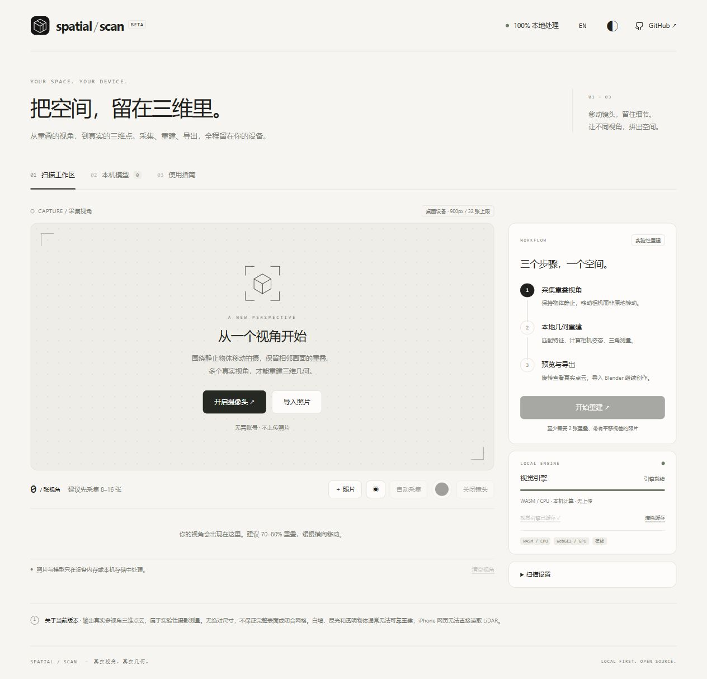

# Spatial Scan

Local-first browser photogrammetry: capture overlapping photographs, reconstruct real three-dimensional points, and export the result without uploading your scan.

[Open Spatial Scan](https://unowhatpvp-alt.github.io/spatial-scan/) · [中文说明](README.zh-CN.md)

Spatial Scan is an experimental **point-cloud reconstruction** tool. It estimates camera motion and triangulates observations across photographs. It does not promise a complete room, a closed mesh, or measurement-grade dimensions.



## What it does

- Capture camera views manually or automatically, or import photographs.
- Reconstruct colored points using ORB features, multiview geometry, PnP registration, and optional stereo patch matching.
- Inspect the result in an interactive viewer and save models in this browser.
- Export GLB point geometry or colored PLY for further processing.
- Switch between Chinese and English, light and dark themes, and prepare the engine for offline use.

All scan processing runs on your device. The app downloads its own static files and an approximately 11 MB OpenCV/WebAssembly engine from the same site. It has no scan-upload endpoint, analytics, third-party runtime requests, or cloud inference. Links to GitHub navigate there only when opened.

## Make a scan

1. Open the app over HTTPS. Choose a stationary, textured object in even light; begin with one side of a small object.
2. Enable the camera or import photographs in capture order. Keep the same lens, zoom, orientation, and aspect ratio throughout.
3. Move the camera sideways around the subject, keeping approximately 70–80% overlap. Turning in place does not supply enough parallax. Start with 8–16 views; the interface requires at least two.
4. Check the estimated horizontal field of view in **Scan settings**. The default 60° is a guess, not camera calibration.
5. Start reconstruction. Inspect the registered-view count and reprojection error, then rotate the point cloud to check its shape.
6. Export GLB or PLY, or save to the local library. Export scaling changes relative coordinates; it does not establish real-world units.

GLB uses the glTF `POINTS` primitive, not triangles. Support for point primitives varies among viewers and importers. PLY provides colored vertices as an alternative. Neither format automatically creates a surface in Blender.

For offline use, open the app online and let background preparation finish; select **Prepare offline engine** if a retry is needed. Wait for the cache-ready status. Reopen the same URL while offline. Browser cache eviction, private browsing, permissions, and storage limits can affect availability. Export important results; clearing website data removes the local library.

## Scope and devices

| Path | Current scope |
| --- | --- |
| Modern desktop browsers | Camera/photo input, local WASM computation, WebGL2 preview |
| iPhone/iPad Safari | Intended camera/photo path; physical device quality and stability remain unverified |
| Low-memory devices | Smaller processing images and a 24-view cap; higher profile supports 32 views |
| Hardware depth | No direct ARKit, iPhone LiDAR, or WebXR depth integration |

Blank walls, repeating patterns, reflections, transparency, moving subjects, and blur often fail. Focal estimation, lens distortion, limited overlap, drift, and the absence of global bundle adjustment limit accuracy. Stereo densification adds checked samples where matching succeeds; gaps remain where evidence is insufficient. This version uses classical vision rather than a neural depth model.

The pipeline has been tested on synthetic multiview scenes and a public, rectified stereo photograph pair. The desktop browser photo workflow, local-library persistence, GLB download, and Blender point import have also been checked. These tests do not establish handheld, iPhone, or full-room performance. See the [validation record](docs/validation.md).

## Development

Use Node.js 22 or newer and pnpm 11.25.0.

```sh
pnpm install --frozen-lockfile --ignore-scripts
pnpm test
pnpm build
pnpm dev
```

The development server serves the built `dist/` directory at `http://127.0.0.1:4173`. Rebuild and reload after source changes.

The repository tracks source, tests, and the lockfile. Dependencies, generated output, and local validation assets stay out of Git. GitHub Actions tests and builds pushes to `main`, then deploys the artifact to GitHub Pages. For a fork, set **Settings → Pages → Source → GitHub Actions** and update the project links if needed.

[Architecture](docs/architecture.md) · [Validation](docs/validation.md) · [Contributing](CONTRIBUTING.md)

## License

Project code is available under the [MIT license](LICENSE). Third-party dependencies retain their respective licenses.
